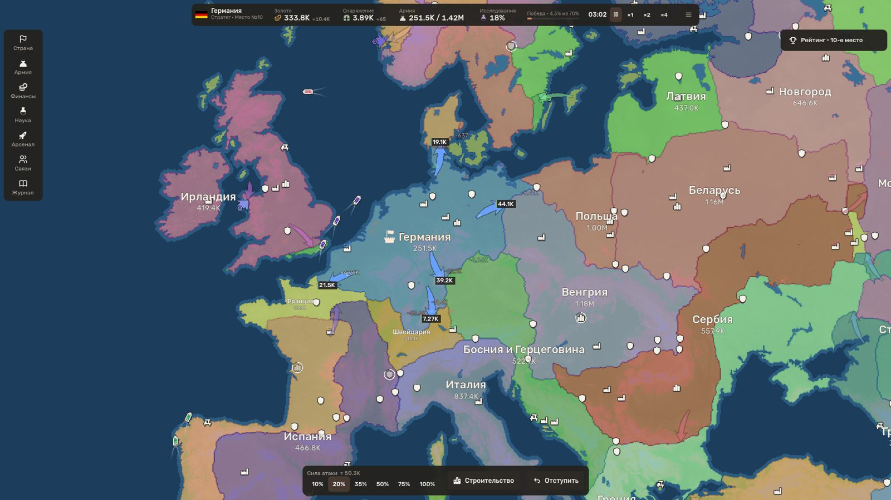
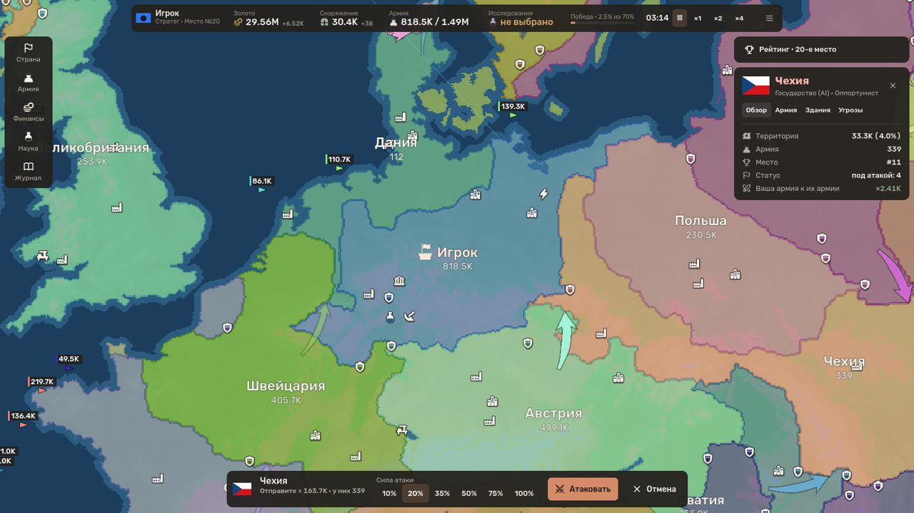
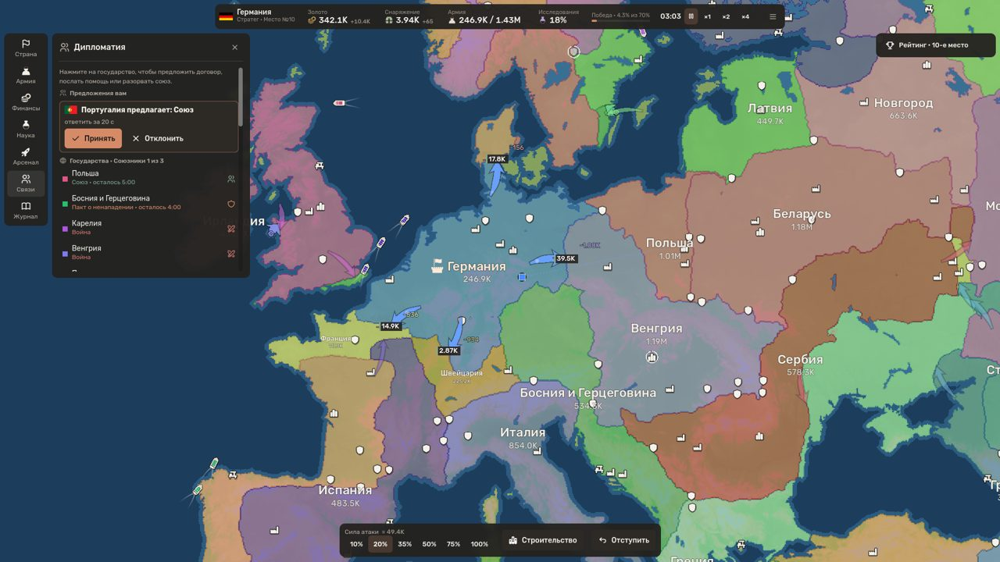
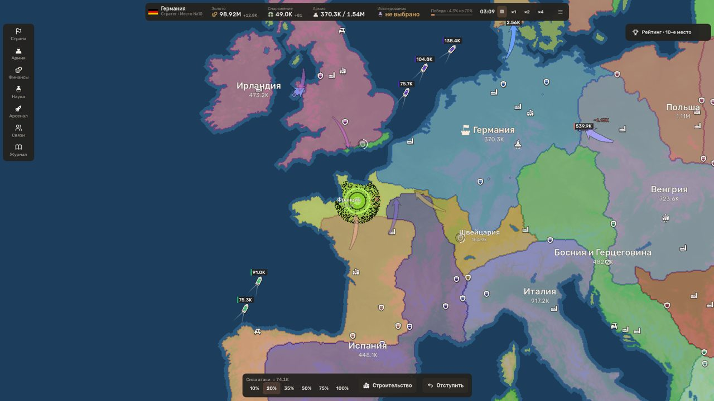
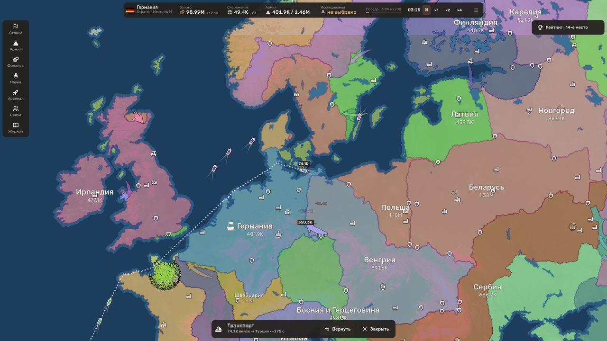
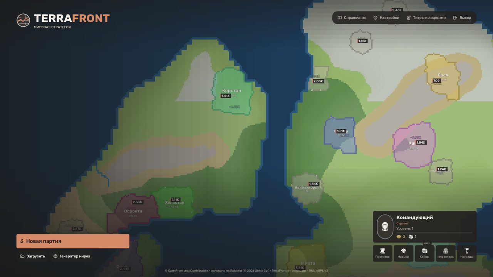
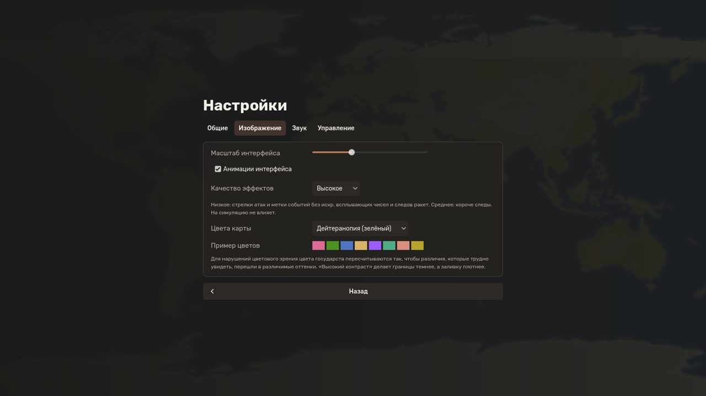

<div align="center">


<h1>TerraFront</h1>

<p><b>Стратегия захвата территорий: целые страны, морские десанты, ядерное оружие и дипломатия — против
умных AI-противников, на реальной карте мира или в сгенерированных мирах.</b></p>

<p>
<a href="https://github.com/volnalabs/game/releases/latest"></a>


<a href="LICENSE"></a>
</p>

<h3>
<a href="https://github.com/volnalabs/game/releases/latest/download/TerraFront-windows-x64.zip">⬇ Скачать для Windows</a>
&nbsp;·&nbsp;
<a href="https://github.com/volnalabs/game/releases/latest/download/TerraFront-linux-x64.tar.gz">⬇ Скачать для Linux</a>
</h3>

<sub>Бесплатно · без установки и регистрации · играется офлайн · <a href="https://github.com/volnalabs/game/releases">все версии</a></sub>

<br><br>



</div>

## Об игре

Вы — молодое государство на карте мира. Захватывайте ничейную землю, стройте города и фабрики,
изучайте технологии — и решайте, с кем воевать, а с кем договориться. Каждая атака идёт по всей общей
границе, и её исход зависит от рельефа, плотности войск и укреплений. Побеждает тот, кто займёт
нужную долю суши (или останется последним).

<table>
<tr>
<td width="50%"><br><b>Живые фронты.</b> Атакуйте выбранной долей армии: фронт идёт по всей общей
границе, стрелки показывают, кто куда наступает и с какими силами.</td>
<td width="50%"><br><b>Дипломатия.</b> Союзы и пакты о ненападении, посылки войск и золота союзникам,
просьбы о помощи. Разорвёте договор — станете предателем. Есть командные партии.</td>
</tr>
<tr>
<td width="50%"><br><b>Оружие и ПВО.</b> Ракеты, авиаудары, артиллерия, ЭМИ и ядерное оружие с
радиоактивными осадками. ЗРК перехватывают удары — свои и союзные.</td>
<td width="50%"><br><b>Десанты и умные противники.</b> Транспорт сам прокладывает путь по морю — даже
к цели вглубь чужой страны. AI видит только то, что видит игрок, учится на ошибках, договаривается и иногда предаёт.</td>
</tr>
</table>

### Что есть в игре

- 🌍 **Карты**: Земля и 5 регионов (Natural Earth), вымышленные Пелагия, Аварис и Расколотые миры,
  генератор миров с 6 пресетами — каждый seed даёт новый мир.
- 🏙 **15 зданий** и экономика: золото от ценности земли, снаряжение, содержание армии.
- 🔬 **Исследования** в партии и **перки** профиля; уровни, награды, кейсы с косметикой, достижения.
- 🚢 **Морские десанты** с видимым маршрутом; транспорт можно вернуть.
- ☢ **Вооружение**: 9 видов оружия, ПВО, радар, ядерные осадки.
- 🤝 **Дипломатия и команды** (2–4 команды, общая победа).
- 📖 **Справочник** (F1) и подсказки: каждый показатель и каждая недоступная кнопка объясняют себя.
- 🔊 Звук, синтезированный самой игрой; ⌨ переназначение клавиш; 🎨 режимы цветов для дальтонизма;
  русский и английский языки.

<div align="center">
 
</div>

## Как начать

1. Скачайте архив для своей системы (ссылки выше).
2. Распакуйте его в любую папку.
3. Запустите **TerraFront.exe** (Windows) или **./TerraFront.x86_64** (Linux).

> Windows может показать «Windows защитила ваш компьютер» — файл не подписан цифровой подписью.
> Нажмите «Подробнее» → «Выполнить в любом случае».

**Системные требования**: Windows 10/11 или Linux, 64 бит; видеокарта с OpenGL 3.3; 4 ГБ ОЗУ;
~200 МБ на диске. Сохранения и настройки: `%APPDATA%\Godot\app_userdata\TerraFront\` (Windows),
`~/.local/share/godot/app_userdata/TerraFront/` (Linux).

### Управление

| Действие | Клавиши |
|---|---|
| Атаковать землю / десант за море | ЛКМ по чужой или ничьей земле |
| Сила атаки (доля армии) | Q / E |
| Информация о государстве | ПКМ |
| Камера | WASD, перетаскивание ПКМ/СКМ, колесо — масштаб |
| Строительство / быстрые постройки | B / 1–6 |
| Пауза / скорость | Пробел / + − |
| Справочник / сохранить / меню | F1 / F5 / Esc |

Все клавиши, кроме Esc, можно переназначить: «Настройки → Управление».

### Игра с другом

Пока TerraFront — одиночная игра. В версии 0.3.0 появится игра по сети: хост нажимает «Пригласить»,
отправляет код другу в любой мессенджер (хоть в чат Steam), друг вставляет код — и вы в одной партии.
Без серверов и регистрации.

## Для разработчиков

<details>
<summary>Запуск из исходников, тесты и сборка</summary>

```bash
GODOT=$(tools/get_godot.sh)           # скачивает Godot 4.7.2 (MIT) в ~/.local/godot
$GODOT --path godot --import
$GODOT --path godot                    # или откройте godot/project.godot в редакторе и нажмите F5
```

```bash
$GODOT --headless --path godot -s res://tests/run_tests.gd       # 193 теста, ~7 мин
$GODOT --headless --path godot -s res://scripts/tools/ai_sim_cli.gd -- --games 20 --map gen:continents:S --bots 8 --mode strategic_vs_legacy --seed 1
$GODOT --headless --path godot -s res://scripts/tools/bench_cli.gd -- --map earth --bots 40 --tribes 60
tools/release/package.sh               # архивы для Windows и Linux в build/release/
```

Релиз публикуется автоматически (`.github/workflows/release.yml`) при пуше тега `vX.Y.Z`, совпадающего
с `config/version` в `godot/project.godot`; описание берётся из [CHANGELOG.md](CHANGELOG.md).

Документация: [устройство](docs/architecture/ARCHITECTURE.md) ·
[правила](docs/game-design/GAME_DESIGN.md) · [AI](docs/ai/AI_DESIGN.md) ·
[результаты AI](docs/ai/AI_RESULTS.md) · [карты](docs/maps/MAP_SYSTEM.md) ·
[десанты](docs/game-design/NAVAL_LANDINGS.md) · [оружие](docs/game-design/WEAPONS.md) ·
[дипломатия](docs/game-design/DIPLOMACY.md) · [звук](docs/game-design/AUDIO.md) ·
[настройки](docs/game-design/SETTINGS.md) · [интерфейс](docs/ui/UI_DESIGN.md) ·
[производительность](docs/performance/PERFORMANCE.md) · [сборка](docs/release/WINDOWS_EXPORT.md) ·
[лицензии ресурсов](docs/licensing/ASSET_LICENSES.md)

</details>

## Лицензия и авторы

TerraFront разрабатывает студия **VolnaLabs**. Игра выросла из **RoWorld** (© 2026 Snick Co.),
модифицированной версии **OpenFront**.

**© OpenFront and Contributors** · основано на RoWorld · TerraFront © VolnaLabs.
Распространяется по лицензии **GNU AGPL v3** с дополнительными условиями §7 ([LICENSE](LICENSE)):
исходный код любой версии открыт в этом репозитории.

Карты — Natural Earth и NOAA ETOPO1 (public domain); шрифт Rubik (SIL OFL 1.1); иконки Game-icons.net
(CC BY 3.0) и Tabler (MIT); флаги — Wikimedia Commons; движок Godot Engine (MIT). Полный список —
[ASSET_LICENSES.md](docs/licensing/ASSET_LICENSES.md) и экран «Титры» в игре.

---

<details>
<summary><b>English</b></summary>

**TerraFront** is a free, offline territory-conquest strategy game by VolnaLabs: whole-border attacks,
sea landings deep into enemy land, 15 buildings, research, missiles and nuclear weapons with fallout,
air defence, alliances and team matches — against strategic AI opponents (5 personalities, 3
difficulty levels) on the Earth map, regional and fictional maps or generated worlds. Russian and
English UI.

**Download**: [Windows](https://github.com/volnalabs/game/releases/latest/download/TerraFront-windows-x64.zip) ·
[Linux](https://github.com/volnalabs/game/releases/latest/download/TerraFront-linux-x64.tar.gz) — unzip and
run; no installation. Online play with an invite code is planned for 0.3.0.

Licence: GNU AGPL v3 with additional terms (§7). © OpenFront and Contributors · based on RoWorld ·
TerraFront © VolnaLabs.

</details>
